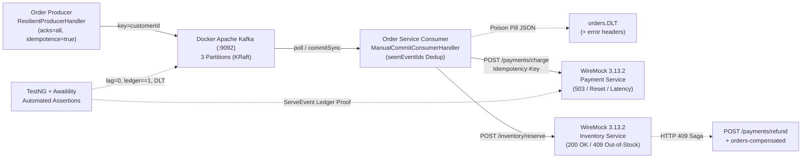

# microservice-resilience-lab

[](https://openjdk.org/projects/jdk/17/)
[](https://kafka.apache.org/)
[](https://www.docker.com/)
[](https://wiremock.org/)
[](https://testng.org/)
[](https://github.com/pranesh-SDET/microservice-resilience-lab/actions/workflows/java17-resilience-ci.yml)

A Java 17 distributed-systems QA lab verifying **asynchronous Kafka observability** and **synchronous microservice chaos resilience**—grounded in **Netflix ChAP (`arXiv:1905.04648`)** and **SequenceFI (`arXiv:2607.20050`)** temporal fault-injection research.

> **Interactive Learning Hub (Read-Only):** Explore the clickable architecture diagram and step through all 7 tests as a read-only simulation in your browser:
> [https://pranesh-SDET.github.io/microservice-resilience-lab/](https://pranesh-SDET.github.io/microservice-resilience-lab/) *(Enable GitHub Pages on `/docs` to activate)*

---

## Architecture Overview



---

## Why This Lab Exists (Week 1 → Week 2)

Most Kafka and microservice tutorials stop at the happy path—using `enable.auto.commit=true`, a single partition, and eyeball verification across two terminal windows. Real production incidents happen at the seams between async messaging and flaky downstream APIs:

| Production Risk | Typical Demo Flaw | Guardrail Implemented Here |
| :--- | :--- | :--- |
| **Out-of-order customer events** | Single-partition topic with random keys | 3-partition topic keyed by `customerId` with strict ascending offset verification |
| **Silent message loss on crash** | `enable.auto.commit=true` | Explicit `enable.auto.commit=false` + per-record `commitSync()` after processing |
| **Stuck consumer on malformed JSON** | Uncaught parse exception halts partition | `DeadLetterHandler` routes poison pills to `<topic>.DLT` with diagnostic headers |
| **Double-charging on retry** | Plain HTTP retry without ledger state | `Idempotency-Key` + WireMock scenario state (`STARTED` → `CHARGED`) + `ServeEvent` ledger count = `1` |
| **Orphaned charges on stock failure** | Retrying HTTP `409` business rejections | Zero-retry Saga compensation calling `/payments/refund` and emitting `orders-compensated` |
| **Flaky `Thread.sleep()` test suites** | Hardcoded waits & noisy `DEBUG` logs | `Awaitility` lag polling (`lag == 0`) + `CountDownLatch` rebalance sync + `Log4j 2` noise filtering |

---

## Automated Test Matrix

All 7 automated TestNG checks execute repeatably via `mvn clean test`:

| Suite | Test Case | Fault / Scenario Tested | Key Assertion |
| :--- | :--- | :--- | :--- |
| **`KafkaObservabilityTest`** | `testPartitionKeyStickinessAndOffsetOrdering` | 5 sequential `cust-42` orders across a 3-partition topic | All 5 records land on the exact same partition with strictly ascending offsets (`0..4`) |
| **`KafkaObservabilityTest`** | `testConsumerLagDrainsToZeroAndDeduplicatesEvents` | 3 produced events containing 1 duplicate `eventId` | Exactly 2 unique orders processed; Admin API verifies consumer group lag drains to `0` |
| **`KafkaObservabilityTest`** | `testPoisonPillIsolatedToDeadLetterTopic` | Corrupted JSON payload placed between 2 valid orders | Both valid orders succeed; malformed record lands in `.DLT` with `dlt-error-class` header |
| **`PaymentTemporalFaultInjectionTest`** | `testWindow1_FailureBeforeSideEffect_PlainRetrySucceedsOnce` | **Window 1 (Pre-Effect):** `HTTP 503` before payment commit | Retry succeeds on attempt 2; ledger commits `== 1` |
| **`PaymentTemporalFaultInjectionTest`** | `testWindow2_FailureAfterCommitReplyLost_IdempotentRetryAndConsumerDedup` | **Window 2 (Post-Effect):** `CONNECTION_RESET_BY_PEER` after commit + duplicate Kafka delivery | Idempotent replay returns `200`; duplicate event ignored; ledger commits `== 1` |
| **`PaymentTemporalFaultInjectionTest`** | `testWindow3_DownstreamRejectionAfterCharge_SagaCompensatesWithoutRetryingRejection` | **Window 3 (Downstream Reject):** Charge succeeds, Inventory returns `HTTP 409` | Zero retries on `409`; `/payments/refund` invoked once; `orders-compensated` published |
| **`PaymentTemporalFaultInjectionTest`** | `testNetflixLatencyVariants_UnderAndOverClientTimeout` | **Netflix ChAP Latency Cutoff:** `150ms` (under `1000ms` timeout) vs. `1400ms` (over timeout) | Under-timeout = 1 request; over-timeout triggers safe idempotent retry with ledger commits `== 1` |

---

## Project Structure

```text
microservice-resilience-lab/
├── .github/
│   └── workflows/
│       └── java17-resilience-ci.yml           # Automated CI pipeline (Java 17 + Maven + WireMock)
├── docs/
│   └── index.html                             # Read-only Interactive Learning Hub (GitHub Pages)
├── src/
│   ├── main/
│   │   ├── java/com/resilience/lab/
│   │   │   ├── core/
│   │   │   │   ├── ManagedKafkaClient.java    # AutoCloseable lifecycle + safe JVM shutdown hook
│   │   │   │   └── RecordProcessor.java       # Functional processing contract
│   │   │   ├── configs/
│   │   │   │   └── KafkaConfigFactory.java    # Isolated Producer, Consumer & Admin configs
│   │   │   ├── model/
│   │   │   │   └── OrderEvent.java            # Immutable Java 17 domain record
│   │   │   ├── helper/
│   │   │   │   ├── EventPayloadHelper.java    # Jackson JSON serialization helper
│   │   │   │   └── TopicAdminHelper.java      # Multi-partition topic creation & lag calculation
│   │   │   └── handlers/
│   │   │       ├── ResilientProducerHandler.java      # Sync acks=all idempotent producer
│   │   │       ├── DeadLetterHandler.java             # Poison-pill routing with error headers
│   │   │       └── ManualCommitConsumerHandler.java   # Poll -> Process/DLT -> commitSync loop
│   │   └── resources/
│   │       ├── config.properties              # Environment broker defaults
│   │       └── log4j2.xml                     # Clean console + rolling file logging (silences Kafka noise)
│   └── test/
│       └── java/com/resilience/lab/tests/
│           ├── KafkaObservabilityTest.java            # Live Docker Kafka verification suite (3 tests)
│           └── PaymentTemporalFaultInjectionTest.java # WireMock temporal chaos suite (4 tests)
├── .gitignore
├── pom.xml
└── README.md
```

---

## Quick Start

### Prerequisites
* **Java 17** (`java -version`)
* **Apache Maven 3.9+** (`mvn -v`)
* **Docker Desktop** *(only required for the live Kafka suite; WireMock tests run standalone)*

### 1. Run the WireMock Temporal Fault-Injection Suite (No Docker Required)
Runs all 4 microservice chaos tests in ~3 seconds using an embedded WireMock server on a dynamic port:

```bash
mvn test -Dtest=PaymentTemporalFaultInjectionTest
```

*(PowerShell users: wrap the flag in quotes — `mvn test "-Dtest=PaymentTemporalFaultInjectionTest"`)*

### 2. Start Local Apache Kafka (KRaft Mode via Docker)
```bash
docker run -d --name kafka -p 9092:9092 apache/kafka:4.4.0
```

### 3. Run the Full 7-Test Suite (Live Kafka + WireMock)
```bash
mvn clean test
```

Expected summary:
```text
[INFO] Tests run: 7, Failures: 0, Errors: 0, Skipped: 0
[INFO] BUILD SUCCESS
```

Rolling execution logs are saved automatically to `logs/resilience-lab.log`.

---

## Research & Industry Foundations

| Source | Paper | How It Shaped This Lab |
| :--- | :--- | :--- |
| **Netflix** | [*Automating Chaos Experiments in Production* (ChAP)](https://arxiv.org/abs/1905.04648) | Modeled latency-boundary testing (under vs. over client timeout) and automated steady-state assertions |
| **SequenceFI (2026)** | [*Non-Intrusive Temporal Fault Injection*](https://arxiv.org/abs/2607.20050) | Inspired the 3 timing-sensitive payment failure windows (pre-effect, post-effect reply loss, downstream rejection) |
| **Netflix** | [*Chaos Engineering* (IEEE Software)](https://arxiv.org/abs/1702.05843) | Applied steady-state hypothesis verification (`lag == 0`, `ledgerCommits == 1`, zero stuck partitions) |
| **Uber** | [*Scaling Mobile Chaos Testing with AI-Driven Execution* (uHavoc)](https://arxiv.org/abs/2602.06223) | Reinforced isolating downstream RPC failures cleanly across multi-service call chains |

---

## Interactive Learning Hub

A standalone, read-only visual simulator lives in [`docs/index.html`](docs/index.html). You can open it locally in any browser or view the hosted version via GitHub Pages to step through Kafka partition hashing, Dead-Letter Topic isolation, WireMock fault states, and Netflix ChAP latency cutoffs without running Docker locally.
